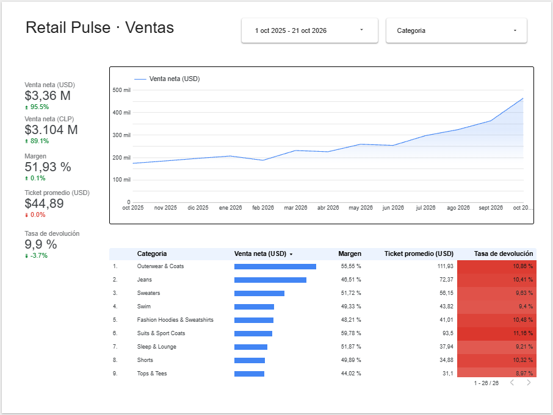
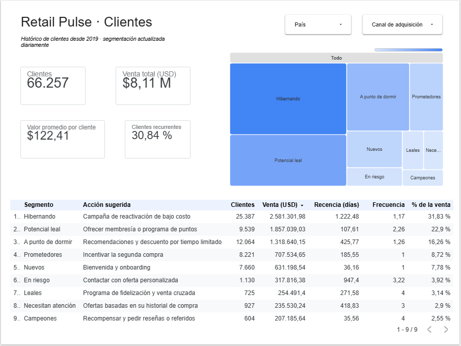
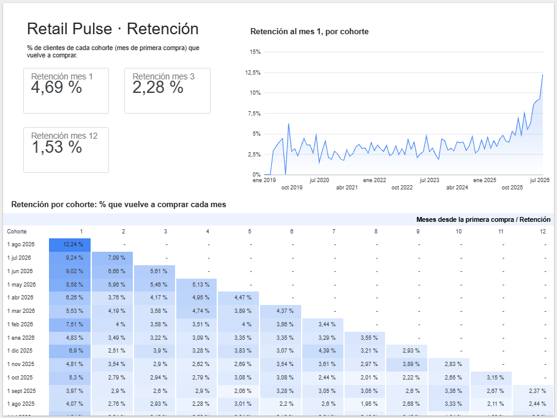

# 🛒 Retail Pulse — BI automatizado para e-commerce

[](https://github.com/GermanIgnacio7991/retail-pulse/actions/workflows/pipeline.yml)
[](https://datastudio.google.com/reporting/a7c23750-48b2-46d8-88f2-b01e4d611d46)

> Pipeline de datos de punta a punta que actualiza cada día las métricas de un retail, valida la calidad de los datos y alimenta un dashboard ejecutivo con ventas en USD y CLP.

**Autor:** Germán Cortés Alegría · [LinkedIn](https://linkedin.com/in/german-ignacio)

---

## 🎯 Problema de negocio

Un e-commerce necesita responder todos los días, sin trabajo manual:

1. ¿Cómo van las ventas, el margen y el ticket promedio por categoría?
2. ¿Cuánto representan en pesos chilenos, considerando el tipo de cambio del día?
3. ¿Qué clientes son más valiosos y cuáles están en riesgo de irse?
4. ¿Qué categoría tuvo una caída anormal y requiere atención? *(semana 4)*

## 🏗️ Arquitectura

```
 mindicador.cl API ──► Python (ingesta) ──► BigQuery: raw
                                                │
 BigQuery public data (thelook_ecommerce) ──────┤
                                                ▼
                                   dbt: staging ──► marts  (+ tests de calidad)
                                                │
                                                ▼
                               Power BI / Looker Studio · Alertas · Reporte IA

 Orquestación: GitHub Actions, todos los días a las 07:17 (hora de Chile)
```

| Capa | Herramienta | Qué hace |
|---|---|---|
| Ingesta | Python, `requests`, `pandas` | Descarga dólar, UF e IPC, avisa si alguno viene atrasado en la fuente y los carga en BigQuery (idempotente) |
| Almacenamiento | BigQuery | Datasets `raw`, `staging`, `marts`, `seeds` |
| Transformación | dbt | Limpieza, modelado dimensional y conversión USD→CLP |
| Calidad | dbt tests | Unicidad, nulos, integridad referencial, frescura de fuentes |
| Orquestación | GitHub Actions | Ejecución diaria y manual |
| Visualización | Looker Studio · Power BI *(en progreso)* | Dashboard ejecutivo de 3 páginas, actualizado cada día |

## 📈 Dashboard

**[▶ Ver dashboard en vivo (Looker Studio)](https://datastudio.google.com/reporting/a7c23750-48b2-46d8-88f2-b01e4d611d46)**: público, sin necesidad de iniciar sesión.

| Página | Responde | Fuente (dbt) |
|---|---|---|
| **Ventas** | Venta neta en USD y CLP, margen, ticket y devoluciones por categoría, con variación vs. el período anterior | `fct_ventas_diarias` |
| **Clientes** | Segmentos RFM, su peso en la venta y la acción sugerida para cada uno | `dim_clientes_rfm` |
| **Retención** | Heatmap de cohortes mensuales y evolución de la retención al mes 1 | `fct_retencion_cohortes` |

Las tasas (margen, devolución, retención) se recalculan desde sus componentes en cada nivel de agregación, en vez de promediar porcentajes.





## 📊 Hallazgos

> *Completa esta sección con números reales cuando tengas el dashboard. Ejemplos de formato:*
> - La categoría X concentra el **__%** de la venta neta del último trimestre.
> - La tasa de devolución promedio es **__%**, con Y como la categoría más alta.
> - El **__%** de los clientes genera el **__%** de las ventas.

## 🗂️ Estructura

```
retail-pulse/
├── ingestion/indicadores.py        # API mindicador.cl → BigQuery raw
├── dbt/retail_pulse/
│   ├── models/staging/             # Limpieza 1:1 de las fuentes + tests
│   ├── models/marts/               # Tablas listas para el negocio
│   ├── seeds/                      # Tablas de referencia en CSV (grilla de segmentos RFM)
│   └── tests/                      # Tests de negocio personalizados
├── .github/workflows/pipeline.yml  # Ejecución diaria
└── docs/SETUP.md                   # Guía paso a paso de configuración
```

## 🚀 Cómo ejecutarlo

Guía completa en [`docs/SETUP.md`](docs/SETUP.md). Resumen:

```bash
python -m venv .venv && source .venv/bin/activate
pip install -r requirements.txt
cp .env.example .env            # completa GCP_PROJECT_ID
gcloud auth application-default login

python ingestion/indicadores.py
cd dbt/retail_pulse && dbt build --profiles-dir .
```

## 🛣️ Roadmap

- [x] Semana 1 — Ingesta automatizada y capa raw
- [x] Semana 2 — Modelos dbt y tests de calidad
- [ ] Semana 3 — Segmentación RFM, cohortes y dashboard
- [ ] Semana 4 — Alertas de anomalías y reporte semanal con IA
- [ ] Semana 5 — Video demo y publicación

## 🧠 Decisiones técnicas

- **Carga idempotente (`WRITE_TRUNCATE`)**: el pipeline se puede re-ejecutar sin duplicar datos.
- **Último dólar disponible**: los fines de semana y feriados no hay dólar observado, así que se arrastra el último valor publicado.
- **RFM adaptado a los datos**: recencia y monto se puntúan por percentiles, pero la frecuencia usa el número de compras directo, porque el 69 % de los clientes compra una sola vez y los quintiles separarían al azar a clientes idénticos.
- **Cohortes con grilla completa**: `fct_retencion_cohortes` genera todas las combinaciones cohorte × mes (con 0 % donde nadie compró) y marca el mes en curso, que está incompleto, para no subestimar la retención en el dashboard.
- **Reglas de negocio en un seed**: la grilla R×F → segmento vive en `seeds/segmentos_rfm.csv`, editable sin tocar SQL y validada por un test que exige las 25 combinaciones.
- **Minimización de datos personales**: los modelos no exponen nombres, emails ni direcciones.
- **Sin credenciales en el repo**: se usan credenciales por defecto de Google y secretos de GitHub.
